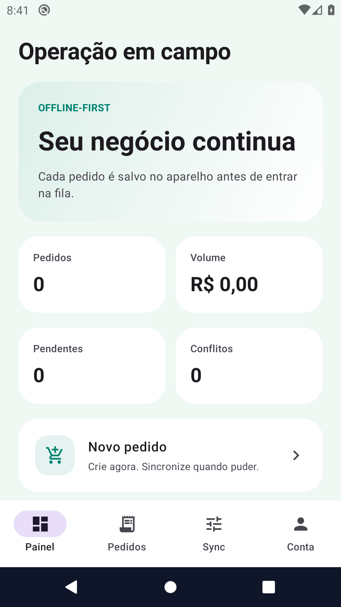
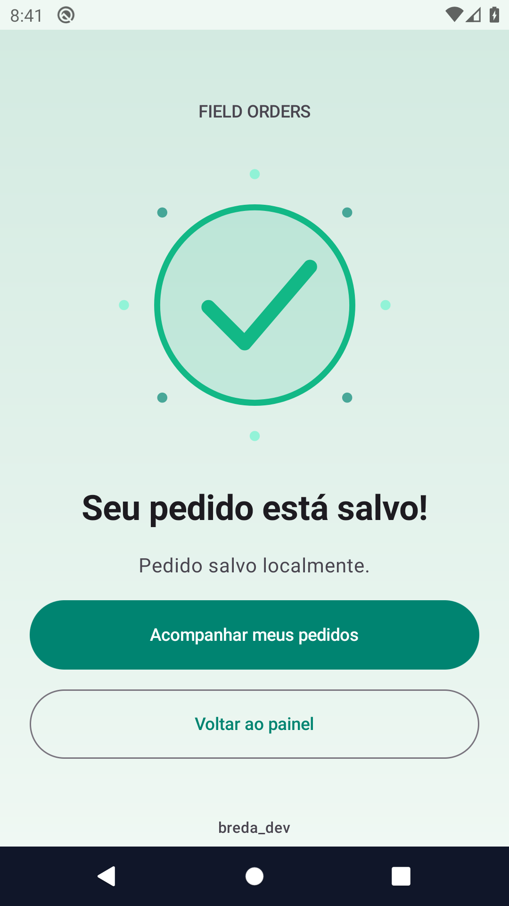

# Field Orders

**Pedidos que continuam disponíveis sem rede, com fila persistente e resolução explícita de conflitos.**

Projeto de **Bruno Breda · breda_dev**. Demonstrar a criação e edição local de pedidos, retentativas e controle de versões sem perder uma edição mais recente durante a sincronização.

**Plataforma:** Android nativo · Kotlin · Room · WorkManager  
**Estado:** implementação de portfólio em evolução; esteira aprovada na execução referenciada.

[Fluxos e demonstração](docs/fluxos.md) · [Engenharia](docs/engenharia.md) · [Builds e evidências](docs/evidencias.md) · [Portfólio completo](https://github.com/brunobredadeveloper/breda-park-wash/blob/main/docs/portfolio-breda-dev.md)

## O que você pode avaliar

- Painel comercial, criação e edição de pedidos, pesquisa e filtros.
- Room como base local e WorkManager para retomada da sincronização.
- Revisões locais e versões remotas com resolução por manter local ou aceitar remoto.
- Namespace por usuário; workers de outra sessão não podem publicar dados na conta atual.

## Telas reais

Capturas do aplicativo executado em emulador Android, recuperadas dos artefatos da esteira. Não são mockups nem fotografias de um aparelho físico. A origem e os limites estão em [evidências](docs/evidencias.md).




## Fluxo principal

1. Entre em modo local e crie um pedido com a simulação offline.
2. Confira o pedido salvo e pendente.
3. Reative a conectividade simulada e agende sincronização.
4. Provoque uma edição remota pelo simulador e abra o conflito.
5. Escolha manter a versão local ou aceitar a remota; observe a mudança de revisão.

## Executar e validar

JDK 17, Android SDK 35 e Android 8+. Use -PincludeAndroid=true para incluir o aplicativo.

```sh
./gradlew -PincludeAndroid=true :core:test :app:testDebugUnitTest :app:lintDebug :app:assembleDebug
```

Configuração, Firebase quando aplicável, assinatura e comandos adicionais: [referência técnica](docs/referencia-tecnica.md).

[Abrir a execução verificada no GitHub Actions](https://github.com/brunobredadeveloper/offline-first-orders/actions/runs/38172947996). A conclusão dessa execução é **success**; consulte os artefatos e a revisão de código em [evidências](docs/evidencias.md).

## Limites do produto

O remoto é um simulador persistente no próprio aparelho; não há servidor de pedidos conectado. Firebase opcional autentica, mas não transforma o simulador em integração com ERP. Não há cobrança financeira real.

## Para quem revisa o portfólio

Equipes de vendas e engenharia mobile interessadas em operações offline-first. As [decisões de engenharia](docs/engenharia.md) conectam responsabilidades, arquivos e testes. O [roteiro funcional](docs/fluxos.md) ajuda a avaliar comportamento, falhas e preservação de dados. Funcionalidade planejada não é apresentada como implementada.

## Próximos passos

- Validar os percursos no dispositivo real e registrar os resultados.
- Revisar acessibilidade, interrupções e falhas de armazenamento/rede aplicáveis.
- Concluir requisitos de distribuição, suporte e segurança antes de uso comercial.

Código, mídias e dependências mantêm seus respectivos termos. Consulte os créditos e os avisos existentes no repositório.
