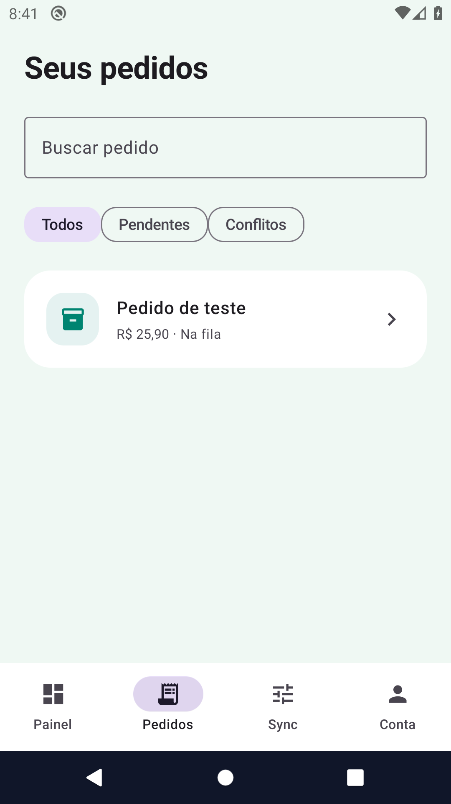

# Fluxos de uso — Field Orders

Demonstrar a criação e edição local de pedidos, retentativas e controle de versões sem perder uma edição mais recente durante a sincronização.

## Mapa de telas

| Tela / área | O que a pessoa faz | Referência de implementação |
|---|---|---|
| Painel | Ver pedidos, volume, pendências e conflitos. | [ProductWorkspace.kt](../app/src/main/kotlin/dev/breda/orders/ProductWorkspace.kt) |
| Novo pedido | Preencher título e valor; salvar antes de sincronizar. | [OrderActions.kt](../app/src/main/kotlin/dev/breda/orders/OrderActions.kt) |
| Pedidos e detalhes | Pesquisar e acompanhar revisões. | [ProductWorkspace.kt](../app/src/main/kotlin/dev/breda/orders/ProductWorkspace.kt) |
| Conflitos | Escolher qual versão preservar. | [OrdersRepository.kt](../app/src/main/kotlin/dev/breda/orders/OrdersRepository.kt) |
| Sync e conta | Acompanhar fila, rede simulada e sessão. | [OrdersApplication.kt](../app/src/main/kotlin/dev/breda/orders/OrdersApplication.kt) |

## Demonstração guiada

Use dados fictícios, em ambiente de avaliação.

1. Entre em modo local e crie um pedido com a simulação offline.
2. Confira o pedido salvo e pendente.
3. Reative a conectividade simulada e agende sincronização.
4. Provoque uma edição remota pelo simulador e abra o conflito.
5. Escolha manter a versão local ou aceitar a remota; observe a mudança de revisão.

## Casos que merecem atenção

- Um ACK antigo não pode sobrescrever uma edição local posterior.
- Retentativa não deve duplicar a mesma revisão de pedido.
- Troca de conta não pode reaproveitar uma tarefa de outra sessão.

## Escopo e resultado esperado

O remoto é um simulador persistente no próprio aparelho; não há servidor de pedidos conectado. Firebase opcional autentica, mas não transforma o simulador em integração com ERP. Não há cobrança financeira real.

## Galeria e contexto

As imagens abaixo representam um instante de uma execução automatizada. Uma captura estática não demonstra som, suavidade de animação, latência ou persistência.

### Painel inicial

### Resultado de sucesso

### Histórico

## Checklist para validação do proprietário

- [ ] Instalar/abrir a versão correspondente às evidências.
- [ ] Percorrer a jornada principal e uma condição de falha.
- [ ] Confirmar navegação, retorno, teclado e leitura em tela pequena.
- [ ] Fechar/reabrir e verificar os dados que devem persistir.
- [ ] Avaliar os recursos nativos pertinentes no aparelho real.
- [ ] Registrar versão, aparelho, resultado esperado e observado em eventual relato.

[Voltar ao README](../README.md) · [Evidências](evidencias.md)
